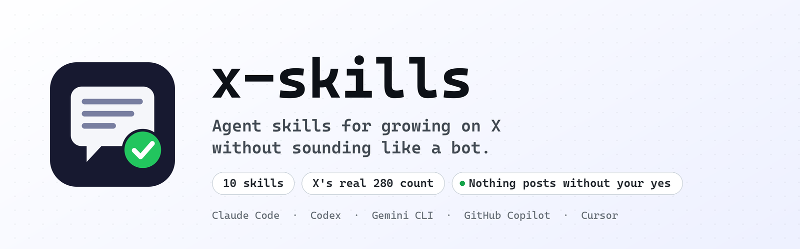
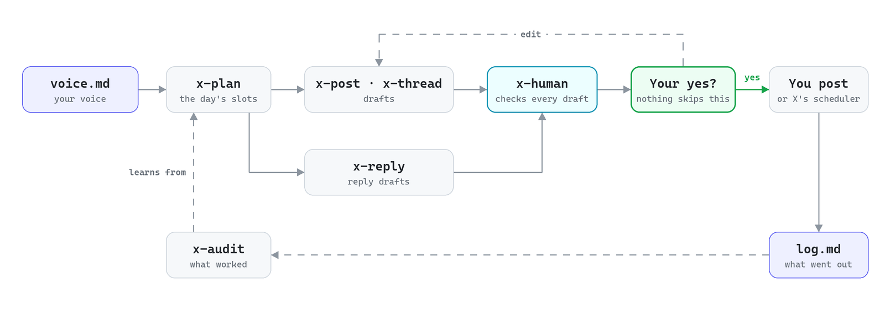
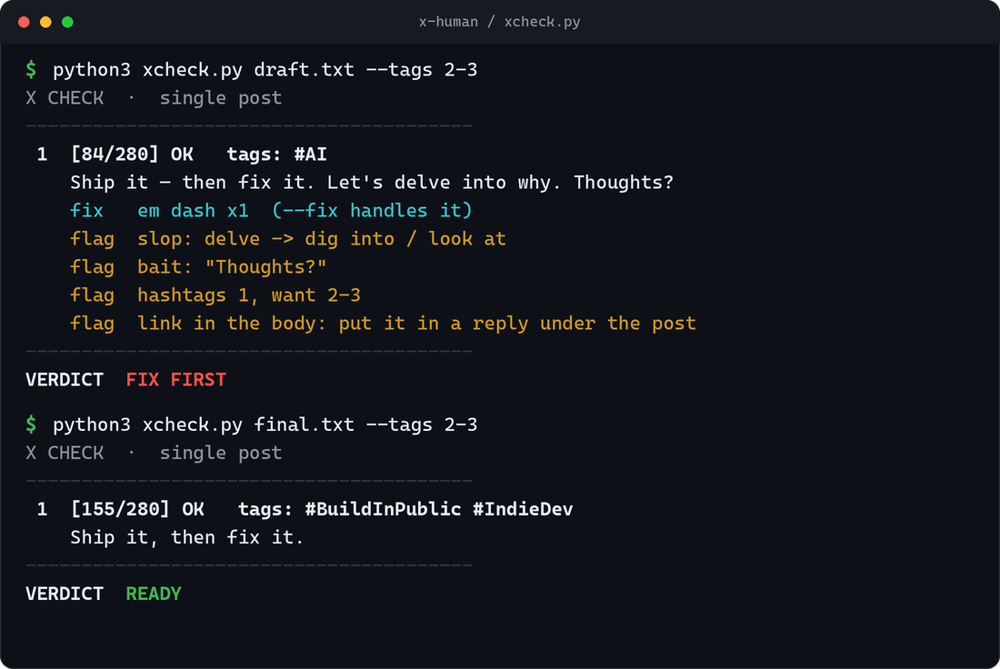

<a id="top"></a>

<p align="center">
  <picture>
    <source media="(prefers-color-scheme: dark)" srcset=".github/assets/banner-dark.png">
    
  </picture>
</p>

<p align="center">
  <a href="https://github.com/Alok-Fusion/x-skills/actions/workflows/ci.yml"></a>
  <a href="LICENSE"></a>
  <a href="https://agentskills.io"></a>
  <a href="#the-skills"></a>
  
</p>

<p align="center">
  <a href="#quick-start"><b>Quick start</b></a> ·
  <a href="#the-skills"><b>The skills</b></a> ·
  <a href="#how-it-works"><b>How it works</b></a> ·
  <a href="#the-checker"><b>The checker</b></a> ·
  <a href="#guardrails"><b>Guardrails</b></a> ·
  <a href="#faq"><b>FAQ</b></a>
</p>

---

**x-skills** is a set of ten [Agent Skills](https://agentskills.io) that turn your AI agent into
a careful co-pilot for X (Twitter). It plans your day, writes posts and threads in *your* voice,
drafts replies that add something, reads what actually worked, and checks every draft against
X's real character count before you see it.

It runs inside the agent you already use, needs no X API key, and **never posts anything
without your yes.**

## Why it exists

AI-written social posts tend to read like a news feed, and they perform like one. On the
first day of running an account this way, plain news recaps got **4 to 14 views**. The one
post about the author's own project got **34 views and every reply**.

There were skill packs for LinkedIn, but nothing for X. So x-skills is built around that one
lesson: **be the person, not the feed.** Specific stories over recaps, replies over volume,
and a hard gate before anything goes out.

## Highlights

<table>
  <tr>
    <td width="33%" valign="top">
      <h3>🧭 Plans the day</h3>
      Slots with a specific angle, a hook formula and a verified source for each, plus ten accounts worth replying to.
    </td>
    <td width="33%" valign="top">
      <h3>✍️ Writes in your voice</h3>
      One shared <code>voice.md</code> holds your tone, positions and proof. 18 hook formulas made for 280 characters.
    </td>
    <td width="33%" valign="top">
      <h3>📏 Counts like X does</h3>
      Links count as 23, emoji as 2, CJK as 2. No more posts that look like 270 and come out at 296.
    </td>
  </tr>
  <tr>
    <td width="33%" valign="top">
      <h3>💬 Replies that land</h3>
      Picks posts 10-100x your size while they're fresh, then drafts replies in ten types. You post them by hand.
    </td>
    <td width="33%" valign="top">
      <h3>📊 Honest audits</h3>
      Engagement rate, reply ratio, bookmark ratio and reach multiple. It says when your sample is too small to tell.
    </td>
    <td width="33%" valign="top">
      <h3>🛑 You stay in control</h3>
      Drafts stop at an approval gate. No auto-posting, no invented stats, no news written from memory.
    </td>
  </tr>
</table>

## Quick start

> [!TIP]
> The skills call each other (everything runs through `x-human`, and `x-post` holds the hook
> library), so install the whole pack, not single skills.

### Claude Code

```bash
claude plugin marketplace add Alok-Fusion/x-skills
claude plugin install x-skills@alok-fusion
```

Skills appear as `/x-skills:x-post`, `/x-skills:x-daily` and so on, and Claude also picks
them up on its own when you ask for a tweet.

### Gemini CLI

```bash
gemini extensions install https://github.com/Alok-Fusion/x-skills
```

### Codex, GitHub Copilot, Cursor and other SKILL.md agents

```bash
git clone https://github.com/Alok-Fusion/x-skills.git
cd x-skills
./install.sh            # Windows PowerShell: .\install.ps1
```

The installer copies the skills to the shared folders that these tools read:

| Folder | Read by |
| :-- | :-- |
| `~/.agents/skills/` | Codex, Gemini CLI, GitHub Copilot |
| `~/.claude/skills/` | Claude Code, Cursor, GitHub Copilot |

<details>
<summary><b>Installer options</b></summary>

| Option | What it does |
| :-- | :-- |
| `--target agents` / `--target claude` | install to one folder only (PowerShell: `-Target`) |
| `--target <dir>` | install to any other skills folder |
| `--uninstall` | remove what the installer added. Your `~/.x-skills/` files stay |
| `--force` | also replace `x-*` skills it didn't install (otherwise they're skipped) |

If a tool lists every skill twice, reinstall with a single target. In Claude Code, use either
the plugin or the installer, not both.

</details>

### Your first post

Ask your agent something like:

```text
write an X post about the bug I fixed today
```

The first time, `x-post` creates `~/.x-skills/voice.md` from
[the template](skills/x-post/assets/voice-template.md). It asks for your handle, timezone,
audience and hashtag rule, plus three of your own posts so it can match your voice. After
that, try:

| Say | Runs |
| :-- | :-- |
| *"do my X for today"* | `x-daily` |
| *"plan my X week"* | `x-plan` |
| *"reply to these"* + pasted posts | `x-reply` |
| *"what's working on my X?"* + your numbers | `x-audit` |
| *"turn this LinkedIn post into tweets"* | `x-repurpose` |

## The skills

| Stage | Skill | What it does |
| :-- | :-- | :-- |
| **Plan** | [`x-daily`](skills/x-daily/SKILL.md) | The whole morning in one go: what worked, plan, drafts, reply drafts, checks, then it stops for your approval |
| | [`x-plan`](skills/x-plan/SKILL.md) | Today's or this week's slots: type, specific angle, hook number, verified source, plus 10 reply targets |
| **Write** | [`x-post`](skills/x-post/SKILL.md) | Three hook options, then one post that fits 280 by X's count, with your hashtag rule |
| | [`x-thread`](skills/x-thread/SKILL.md) | Outline first, then the thread: an opener that earns the tap, one idea per post, tags on post 1 only |
| | [`x-repurpose`](skills/x-repurpose/SKILL.md) | Turns a LinkedIn post, blog, README, transcript or git history into a week of X posts |
| **Engage** | [`x-reply`](skills/x-reply/SKILL.md) | Finds posts worth replying to and drafts replies in ten types. You post them |
| | [`x-mentions`](skills/x-mentions/SKILL.md) | Sorts the replies under your own posts (question, lead, critic, bot) and drafts answers |
| **Measure** | [`x-audit`](skills/x-audit/SKILL.md) | What worked and what to stop, with the math shown and honesty about small samples |
| | [`x-profile`](skills/x-profile/SKILL.md) | Scores your profile out of 100 on a 12-part rubric, then rewrites bio, pinned post and header |
| **Check** | [`x-human`](skills/x-human/SKILL.md) | The last gate on everything: X's weighted count, hashtags, links, AI tells, engagement bait |

## How it works

<p align="center">
  <picture>
    <source media="(prefers-color-scheme: dark)" srcset=".github/assets/flow-dark.png">
    
  </picture>
</p>

Every skill reads the same `voice.md`, so a plan, a post and a reply all sound like the same
person. Everything that goes out is written to `log.md`, which keeps the next plan from
repeating itself and gives `x-audit` real data to learn from.

## The checker

`x-human` ships a standalone script (Python 3.8+, standard library only) that every other
skill runs before showing you a draft. Here it is on a rushed draft, and again on the rewrite:

<p align="center">
  
</p>

| Check | What it catches |
| :-- | :-- |
| **Length** | X's weighted count: links = 23, emoji (including 👨‍💻 and flags) = 2, CJK = 2, Latin and Devanagari = 1 |
| **Hashtags** | Too few or too many for your rule, and tags on posts after a thread's opener |
| **Link in body** | Flags it so the link goes in a reply under the post |
| **Fingerprint** | Em dashes, curly quotes, `…` and invisible characters. `--fix` cleans these |
| **AI tells** | *delve*, *leverage*, *game-changer* and friends, each with a plain alternative |
| **Bait** | "Thoughts?", "Agree?", "RT if", "follow for more" |
| **Threads** | Numbering that skips or totals that don't match |

Run it on its own:

```bash
python3 skills/x-human/scripts/xcheck.py post.txt --tags 2-3
python3 skills/x-human/scripts/xcheck.py thread.txt          # posts separated by a --- line
python3 skills/x-human/scripts/xcheck.py post.txt --fix -o clean.txt
```

`--fix` only touches mechanical characters. Wording is always left to you. To add your own
words, or keep one you really use, edit `~/.x-skills/slop.json`.

## Guardrails

> [!IMPORTANT]
> **Nothing is posted, replied, liked, followed or scheduled without your explicit yes** for
> those exact posts. Replies to other people are always posted by you, by hand, because X
> restricts automated replies.

- **No made-up facts.** No invented stats, users, quotes or "I tried X" you didn't do. A
  missing number becomes `{{number}}` and gets flagged.
- **No news from memory.** Every story is checked against a primary source, and the source
  goes in the receipt.
- **No outrage farming.** It skips scandal, allegations and investment tips, even when
  they're trending.
- **No promises.** The checks are local heuristics plus X's public counting rules. They can't
  predict X's ranking or an AI detector, and the skills won't claim they can.

## Compatibility

| Agent | Install | Status |
| :-- | :-- | :-- |
| Claude Code | plugin marketplace | ✅ Verified: validator, install and all 10 skills loading |
| Gemini CLI | extension | Built to the official extension format |
| OpenAI Codex | `install.sh` → `~/.agents/skills` | Built to the official skills locations |
| GitHub Copilot | `install.sh` | Built to the official skills locations |
| Cursor | `install.sh` → `~/.claude/skills` | Built to the official skills locations |

Anything else that reads `SKILL.md` folders can use the skills too: point `--target` at its
skills folder.

## Your files

Everything the skills keep is plain Markdown in your home folder, so you can read and edit all
of it:

```text
~/.x-skills/
├── voice.md     your voice, positions, proof, routine and hashtag rule
├── log.md       what went out, so nothing repeats
├── plan.md      today's or this week's plan
├── audit.md     what's working, with dates
├── slop.json    optional: your own additions to the AI-word list
└── drafts/      one file per day
```

## FAQ

<details>
<summary><b>Does it post for me?</b></summary>

Not by default. It writes drafts and stops. If you set it up in `voice.md`, and your agent has
a browser where you're already signed in, it can queue approved posts in X's own scheduler
after you say yes. It never uses a third-party auto-poster, and it never types your password.

</details>

<details>
<summary><b>Do I need the X API or X Premium?</b></summary>

No. It works from what you paste, or from reading your own profile in a browser if your agent
has one. Without Premium it assumes 280-character posts. Premium analytics exports make
<code>x-audit</code> sharper, but they're optional.

</details>

<details>
<summary><b>Could this get my account flagged?</b></summary>

The skills don't automate actions on X. Replies are always posted by you, and any scheduling
goes through X's own scheduler, only when you allow it. The writing rules also steer clear of
spam patterns like engagement bait, hashtag walls and mass replies. How you use your account
is still up to you, so read X's rules if you're unsure.

</details>

<details>
<summary><b>Which AI models does it work with?</b></summary>

Any agent that supports Agent Skills. The skills are plain Markdown instructions plus one small
Python script, with no model-specific features.

</details>

<details>
<summary><b>How do I update?</b></summary>

- **Claude Code:** `claude plugin marketplace update alok-fusion`, then
  `claude plugin update x-skills@alok-fusion`, and restart.
- **Gemini CLI:** `gemini extensions update x-skills`
- **Installer:** `git pull`, then run `./install.sh` again. Your `~/.x-skills/` files are never
  overwritten.

</details>

## Contributing

Issues and pull requests are welcome, especially new hook formulas, reply types, and AI-tell
words with plain alternatives. Before opening a PR:

```bash
python3 tools/validate.py              # every skill against the Agent Skills spec + manifests
python3 -m unittest discover -s tests  # the checker's test suite
```

CI runs both on Python 3.8 and 3.14, plus an install and uninstall round trip.

The README images are generated, not hand-made. If you change the checker's output, a skill
name or the banner text, regenerate them with
[`tools/make_readme_art.py`](tools/make_readme_art.py) (needs Pillow and the open
[Cascadia Code](https://github.com/microsoft/cascadia-code) font). The checker image runs the
real `xcheck.py`, so it always shows what the checker currently prints.

## License

[MIT](LICENSE) © 2026 [Alok Kushwaha](https://github.com/Alok-Fusion)

<p align="center">
  <sub>If x-skills helps you sound more like yourself, a ⭐ helps other people find it.</sub><br>
  <sub><a href="#top">Back to top ↑</a></sub>
</p>
